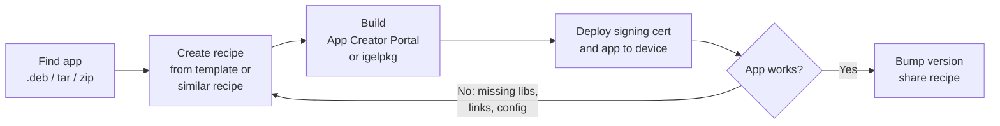

# HOWTO Create OS 12 App Recipes

-----

-----

<!--
Comments
Sources:
- IGEL SDK Reference Manual (Getting Started With the IGEL OS App SDK, Version 2024-07-19): https://github.com/IGEL-Community/IGEL-OS-APP-RECIPES/blob/main/utils/IGEL-SDK-Reference-Manual.pdf
- IGEL KB: IGEL App Creator Portal (snapshot Nov 2025)
- IGEL-Community/IGEL-OS-APP-RECIPES (recipes, README, utils)
- IGEL Community Slack #igel-app-creator-portal (Feb 2025 - Oct 2026)
-->

A recipe is a folder of metadata files and scripts that the IGEL App Creator Portal (or the IGEL OS App SDK, `igelpkg`) turns into a signed IGEL OS 12 app (`.ipkg`). The recipe tells the builder **what** to put in the app (Debian packages, downloaded binaries, your own files), **where** the files go, **how** the app shows up in IGEL Setup / UMS, and **what** runs at install time.

- [IGEL KB: IGEL App Creator Portal](https://kb.igel.com/igel-app-creator/current/igel-app-creator-portal)
- [IGEL SDK Reference Manual](https://github.com/IGEL-Community/IGEL-OS-APP-RECIPES/blob/main/utils/IGEL-SDK-Reference-Manual.pdf) -- details on the files and format of files used in recipes
- <a href="https://github.com/IGEL-Community/IGEL-OS-APP-RECIPES/raw/refs/heads/main/utils/igelpkg-new-template-1.0.0.zip" download>IGEL SDK: Initial Data Structure Template</a>
- [IGEL Community GitHub: IGEL OS APP RECIPES](https://github.com/IGEL-Community/IGEL-OS-APP-RECIPES)
- [IGEL Community Docs: HOWTO Add Applications](./HOWTO-Add-Applications.md)
- [IGEL Community Docs: HOWTO Docker - Using IGEL OS App SDK Docker image](./HOWTO-Docker.md#using-igel-os-app-sdk-docker-image)
- [IGEL Community Slack: #igel-app-creator-portal](https://igelcommunity.slack.com/archives/C08D44B2J2X)
- [IGEL KB: Difference between Apps Created by IGEL and Apps Created by IGEL Ready Partners](https://kb.igel.com/en/apps-created-by-igel-ready-partners/current/difference-between-apps-created-by-igel-and-apps-created-by-igel-ready-partners) -- IGEL supports only the apps IGEL creates

**Please Note:**

- This page is for IGEL OS 12 only. For OS 11 use [Custom Partitions](https://github.com/IGEL-Community/IGEL-Custom-Partitions).
- The IGEL SDK is not needed for creating recipes. The IGEL App Creator Portal runs the IGEL SDK to create and sign your application.
- IGEL App Creator Portal requirements: UMS 12.04+, IGEL OS 12.5+, and an IGEL account with the `App Creator` or `Super Admin` role (assigned in the IGEL Customer Portal).
- For security requirements, the IGEL App Creator Portal only allows Debian and Ubuntu official repository URLs. Use the file upload feature to add other files.
- IGEL is not responsible for, nor grants a license to, the applications created via the App Creator Portal. It is your responsibility to obtain all necessary rights to the components.
- Use underscores, not dashes, in recipe file names and paths (session scripts, folders). Dashes have been reported to break the desktop launcher and icon.
- IGEL OS has no multiarch support, so 32-bit applications (and Wine) are not a good fit. Consider [Docker](./HOWTO-Docker.md#run-wine-in-docker) instead.

-----

-----

## Recipe Workflow



Summary of steps:

- Find the application package (Debian package name, or a vendor `.deb`, `.tar.*`, `.zip`)
- Copy the [template](https://github.com/IGEL-Community/IGEL-OS-APP-RECIPES/raw/refs/heads/main/utils/igelpkg-new-template-1.0.0.zip) or, better, an existing recipe for a similar app
- Edit `app.json`, `igel/*.json`, `data/*`, and add a session start script under `input/all/config/sessions/`
- Build the app with the IGEL App Creator Portal (or `igelpkg`)
- Deploy the app signing certificate and the app to a test device
- Fix missing libraries, links, and settings; rebuild until the app works
- Increase the `version` in `app.json` each time the recipe changes

-----

-----

## Recipe Folder Layout

Example: [SpeedCrunch](https://github.com/IGEL-Community/IGEL-OS-APP-RECIPES/tree/main/APP_Source/Apps/speedcrunch)

```bash linenums="1"
speedcrunch/
├── app.json                          # app name, version, vendor, icons, rw partition
├── README.md                         # disclaimer, where to download binaries, notes
├── .gitignore                        # ignore igelpkg build output
├── data/
│   ├── app.png                       # color icon (App Portal / UMS)
│   ├── monochrome.png                # monochrome icon
│   ├── changelogs/
│   │   └── en                        # release notes
│   ├── descriptions/
│   │   └── en                        # short + long description
│   └── config/
│       ├── config.param              # setup parameters / session definition
│       ├── config.param.locale       # localized display names
│       ├── translation.json          # localized Setup page labels
│       └── ui.json                   # Setup page layout
├── igel/
│   ├── debian.json                   # Debian packages to include
│   ├── dirs.json                     # directories to create (persistent or not)
│   └── install.json                  # which files to include and where
└── input/
    └── all/
        └── config/
            └── sessions/
                └── speedcrunch0      # session start script
```

-----

-----

## What Each File Does

| File | Needed | Purpose |
|------|--------|---------|
| `app.json` | Required | App metadata: technical name, version, author, vendor, display name, icons, categories, read/write partition, dependencies |
| `data/app.svg` (or `.png`) | Required | Color icon shown in the App Portal and UMS. File name is set in `app.json` |
| `data/monochrome.svg` (or `.png`) | Required | Monochrome icon. File name is set in `app.json` |
| `data/descriptions/en` | Required | Short description, empty line, long description (plain text or Markdown) |
| `data/changelogs/en` | Recommended | Release notes shown in the App Portal |
| `data/eula/en` | Optional | End User License Agreement, if the app needs one |
| `data/config/config.param` | Optional | Setup parameters (registry keys) for the app, including session definitions |
| `data/config/config.param.locale` | Optional | Localized display names for the parameters in `config.param` |
| `data/config/ui.json` | Optional | Layout of the app's page in IGEL Setup / UMS profile |
| `data/config/translation.json` | Optional | Labels (per language) used by `ui.json` |
| `igel/debian.json` | One of these two | Debian packages to download and include |
| `igel/thirdparty.json` | One of these two | Other archives (`.deb`, `.tar.*`, `.zip`, ...) to include, with license info |
| `igel/install.json` | Required | Which files (regular expressions) from the packages are included, where they go, owner, permissions, strip |
| `igel/dirs.json` | Optional | Directories to create; `persistent: true` links them to the app's read/write partition |
| `igel/install.sh` | Optional | Runs when the app is installed. Used to enable systemd services |
| `igel/uninstall.sh` | Optional | Runs when the app is uninstalled. Used to disable services and clean up |
| `igel/pre_package_commands.sh` | Optional | Runs at **build time**, before packaging. Used to create files / folders inside the app |
| `igel/input.json` | Optional | Owner / permissions for files coming from `input/` (template default is fine for most recipes) |
| `igel/ignore.json` | Optional | List of file patterns to ignore (template default is fine for most recipes) |
| `igel/variable.json` | Optional | Variables for `igelpkg` templates. **Not supported** by the App Creator Portal in `app.json` or `thirdparty.json` |
| `igel/checksums.json` | Optional | SHA256 checksums of downloaded Debian packages |
| `input/all/...` | Optional | Your own files, copied as-is into the app. Path below `input/all/` is the path on IGEL OS |
| `input/all/config/sessions/<name>0` | For apps with a desktop icon | Session start script. Name must match the session in `config.param` |
| `input/all/etc/systemd/system/*.service` | Optional | systemd service running as root |
| `input/all/etc/systemd/user/*.service` | Optional | systemd service running as user |
| `README.md` | Community repo | Disclaimer, link to the vendor download, file names expected by `thirdparty.json` |

-----

-----

## Where the Files End Up on IGEL OS

| Location on IGEL OS | Contents |
|---------------------|----------|
| `/services/<app_name>/` | The app's read-only partition (everything from `install.json` and `input/all/`) |
| `/services/<app_name>/.icons/` | Icons referenced in `app.json` (handy for the session icon in `config.param`) |
| `/services/<app_name>/etc/setup.def.d/<app_name>/` | Processed `data/config/` files (`.setup.def`, `.setup.def.ui.json`, `.setup.def.translation`) |
| `/services/<app_name>/.licenses/` | One file per license included in the app |
| `/services/<app_name>/.scripts/` | Generated `install.sh`, `cache.json`, `post_mount.sh` |
| `/services_rw/<app_name>/` | The app's read/write partition (only if `rw_partition` is defined in `app.json`) |

- The IGEL App Creator Portal automatically links well-known folders (libraries, `.desktop` files, `udev` rules, `/opt/...`) from `/services/<app_name>` into the file system. For anything else, see [How to add links to /services/application_name](#how-to-add-links-to-servicesapplication_name).

- Persistent directories in `dirs.json` are stored on `/services_rw/<app_name>/` and linked to their normal path. Example: `/userhome/.config/SpeedCrunch` is stored in `/services_rw/speedcrunch/userhome/.config/SpeedCrunch`

-----

-----

## app.json

```json linenums="1"
{
  "categories": [
    "Miscellaneous"
  ],
  "icons": {
    "app": "app.png",
    "monochrome": "monochrome.png"
  },
  "name": "speedcrunch",
  "author": "The IGEL community",
  "vendor": "SpeedCrunch Team",
  "rw_partition": {
    "size": "small",
    "flags": [
      "compressed",
      "prefer_btrfs"
    ]
  },
  "release": "",
  "summary": {
    "en": "SpeedCrunch (Community)"
  },
  "version": "0.12.0+1.1"
}
```

| Key | Meaning |
|-----|---------|
| `name` | Technical name. 3-42 characters, letters, numbers, and underscores (not as first character). Used for `/services/<name>` and `app.<name>` setup parameters. Must be unique |
| `version` | Technical version. Must follow [Semantic Versioning (SemVer)](https://semver.org/). Used for ordering versions in UMS / App Portal and for dependencies |
| `public_version` | Display version. **Must be empty or removed for the IGEL App Creator Portal** |
| `summary.en` | Display name in the App Portal, UMS, and on the device. Community recipes add `(Community)` |
| `author` | Creator of the recipe / package. Required |
| `vendor` | Vendor of the application that is re-packaged. Required |
| `icons.app` / `icons.monochrome` | File names of the icons in `data/` |
| `categories` | List of categories. Community recipes use `Miscellaneous` |
| `rw_partition` | Read/write partition for persistent data (see below) |
| `requires` / `suggests` / `provides` / `conflicts` | Dependencies on other apps. Example: `{"name": "base_system", "version": ">=12.8.0"}` |
| `release` | Leave empty |

**NOTE:** The App Creator Portal does not support variables in `app.json`. `"version": "%version%"` is invalid while `"version": "1.0.0"` is valid.

### Version

- The technical version has two parts: the vendor's version of the application, then `+` and the version of the recipe.

- Community recipes use `<vendor version>+<recipe build>`, for example `0.12.0+1.1` or `15.78.3+1.2`. Bump the part after the `+` when you change the recipe but not the application.

- Version example used for IGEL OS Base OS:

```bash linenums="1"
      base_system-12.6.0
      base_system-12.6.0+1
      base_system-12.6.0+2
      base_system-12.6.1-0.tp.3
      base_system-12.6.1-1.rc.2
      base_system-12.7.0-0.tp.2
```

### Dependencies (requires)

Require a minimum base system or another app, which is installed automatically with your app. Example from [Video Screen Saver](https://github.com/IGEL-Community/IGEL-OS-APP-RECIPES/tree/main/APP_Source/Apps/videoscreensaver):

```json linenums="1"
"requires": [
  {
    "name": "base_system",
    "version": ">=12.8.0"
  },
  {
    "name": "edge",
    "version": ">=142.0.0"
  }
]
```

### Read / Write Partition (rw_partition)

Needed when the app stores data that must survive a reboot (settings, profiles, caches) or when `dirs.json` uses `"persistent": true`.

- `size`: `small`, `medium`, `large` (calculated from the device storage size), or an exact size in KiB without quotes (`2000000` = ~2GB)

- `flags`:

| Flags | File system |
|-------|-------------|
| (none) | EXT4 |
| `compressed` | NTFS |
| `compressed` + `prefer_btrfs` and size >= 128 MB | BTRFS |
| `compressed` + `prefer_btrfs` and size < 128 MB | NTFS |
| `allow_execute` | Allow programs to be executed from the read/write partition |

```json linenums="1"
"rw_partition": {
  "size": "small",
  "flags": [
    "compressed",
    "prefer_btrfs"
  ]
}
```

**NOTE:** Apps that use SQLite (for example 1Password and OneDrive) may not work on a compressed NTFS partition. Use `prefer_btrfs`. Check the file system used for `/services_rw/*`:

```bash linenums="1"
df -Th | grep services_rw
```

-----

-----

## data/

### Icons (data/app.svg, data/monochrome.svg)

- File names are set in `app.json` -> `icons`. SVG is recommended (PNG and JPG are used in some community recipes).
- SVG icons: square, transparent background, `viewBox` attribute aligned to the image border, no filters, no animations.
- Monochrome icon: shapes with fill color only, no strokes.
- The icons are copied to `/services/<app_name>/.icons/` on the device.

### data/descriptions/en

First line is the short description, then an empty line, then the long description (plain text or Markdown). Maximum length in the App Creator Portal is 10,000 characters. Add other languages as additional files (example: `de`).

```bash linenums="1"
A high-precision scientific calculator

SpeedCrunch is a fast, high-precision scientific calculator. It features a syntax-highlighted scrollable display and is designed to be fully used via keyboard.
```

### data/changelogs/en

Release notes. Each main statement starts with `*`, sub-statements with `-` and `--`. End sentences with a full stop.

```bash linenums="1"
* Initial release.
* Added persistent settings folder.
  - Settings are stored in /userhome/.config/SpeedCrunch.
```

### data/eula/en

Optional EULA file, displayed in the App Portal. UMS defines if the EULA is accepted by the user or company-wide.

### data/config/config.param

Defines the setup parameters (registry keys) of the app. Every parameter is prefixed with `app.<app_name>.` by the builder.

#### Session (desktop / start menu icon)

```bash linenums="1"
<sessions>
	<speedcrunch%>
		extends_base=<sessions.base%>
		node_action=<wm_postsetup>
	</speedcrunch%>
	<speedcrunch0>
		<name_localized>
			displayname[en_us]=<SpeedCrunch>
		</name_localized>
		<icon>
			value=<speedcrunch>
		</icon>
		<type>
			displayname[en_us]=<Misc>
		</type>
	</speedcrunch0>
</sessions>
```

- **Lines: 2-5** `<speedcrunch%>` is the session template. `extends_base=<sessions.base%>` adds the standard session settings (start menu, desktop, autostart, etc.). `node_action=<wm_postsetup>` refreshes the desktop when settings change.
- **Lines: 6-16** `<speedcrunch0>` is the session instance. The name must match the start script `input/all/config/sessions/speedcrunch0`.
- **Lines: 10-12** `icon` is either an icon theme name (`speedcrunch`, from `/usr/share/icons`) or a full path such as `/services/speedcrunch/.icons/app.png`.

#### Settings (custom parameters)

Example from [Video Screen Saver](https://github.com/IGEL-Community/IGEL-OS-APP-RECIPES/tree/main/APP_Source/Apps/videoscreensaver):

```bash linenums="1"
<options>
	<idle_seconds>
		value=<300>
		type=<int>
		runtime=<true>
		displayname=<Idle timeout, in seconds>
	</idle_seconds>
	<play_order>
		value=<Random>
		type=<string>
		range=<[Random][By Filename]>
		runtime=<true>
		displayname=<Playlist: Random or in order of File Name sorting>
	</play_order>
	node_action=<runuser -l user -c "systemctl --user restart videoscreensaver.service">
</options>
```

- `range` creates a drop-down list
- `node_action` is the command run when a setting in this node changes
- Read the values on the device with `get`:

```bash linenums="1"
get app.videoscreensaver.options.idle_seconds
```

### data/config/config.param.locale

Localized display names for parameters in `config.param`:

```bash linenums="1"
<sessions>
	<speedcrunch0>
		<name_localized>
			displayname[de_de]=<SpeedCrunch>
		</name_localized>
	</speedcrunch0>
</sessions>
```

### data/config/ui.json

Layout of the app's page in IGEL Setup and in the UMS profile editor. For a single session:

```json linenums="1"
{
  "root": {
    "id": "root",
    "childrenIds": ["base"]
  },
  "base": {
    "id": "base",
    "parentId": "root",
    "nlsResourceId": "title",
    "title": "SpeedCrunch",
    "childrenIds": ["sessions"]
  },
  "sessions": {
    "id": "sessions",
    "parentId": "base",
    "nlsResourceId": "sessions.label",
    "title": "Session",
    "instancePage": true,
    "fixInstanceId": 0,
    "elements": {
      "0": {
        "type": "sessionPage",
        "paramId": "app.speedcrunch.sessions.speedcrunch",
        "instancePageId": "sessions.genericInstancePage"
      }
    }
  }
}
```

- **Line: 23** `paramId` is `app.<app_name>.sessions.<session template name without %>`
- For custom settings use `"type": "generic"` and `"paramId": "app.<app_name>.options.<parameter>"`

**NOTE:** `ui.json` must be valid JSON (no trailing commas). Check with `python3 -m json.tool data/config/ui.json`.

### data/config/translation.json

Labels referenced by `nlsResourceId` in `ui.json`:

```json linenums="1"
{
    "sessions.label": {
        "de": "Sitzung",
        "en": "Session"
    },
    "title": {
        "de": "SpeedCrunch",
        "en": "SpeedCrunch"
    }
}
```

-----

-----

## igel/

### igel/debian.json

Debian packages to download from the official repositories. Licenses are retrieved automatically from most packages.

```json linenums="1"
[
  {
    "package": "speedcrunch"
  }
]
```

If a package has a non-standard license, the build fails and the license must be added. `%tmp%` points to the extracted packages:

```json linenums="1"
[
  {
    "package": "libmcpp0",
    "licenses": [
      {
        "name": "mcpp-2.7",
        "file": "%tmp%/usr/share/doc/libmcpp0/copyright"
      }
    ]
  }
]
```

**NOTE:** Only list packages the app needs that are **not** already in the IGEL OS base system. See [Finding Missing Libraries](#finding-missing-libraries).

### igel/thirdparty.json

Archives that are not from the official Debian / Ubuntu repositories (vendor `.deb`, `.tar.*`, `.zip`).

```json linenums="1"
[
  {
    "url": "file:///tmp/teamviewer_amd64.deb",
    "dest": "",
    "licenses": [
      {
        "name": "GPL-3.0-or-later"
      }
    ]
  }
]
```

| Key | Meaning |
|-----|---------|
| `url` | Location of the archive. Community recipes use `file:///tmp/<file name>`; the App Creator Portal asks you to upload a file with this name |
| `dest` | Optional sub folder for the extracted files. Needed if two archives contain files with the same name |
| `extract` | Optional. `false` copies the file without extracting it. Default is `true` |
| `licenses[].name` | License name, use the [SPDX License List](https://spdx.org/licenses/) identifier |
| `licenses[].text` / `licenses[].file` | License text or license file, if the license is not in the SPDX list |

- Use one object per license. Repeating `"name"` inside one object keeps only the last name.
- The uploaded file name must match the name in `url` exactly. Vendor downloads usually include a version (`yubico-authenticator-7.2.3-linux.tar.gz`, `docker-ce_5%3a29.6.1-1~debian.12~bookworm_amd64.deb`); rename the file to the generic name used in the recipe (`yubico-authenticator-latest-linux.tar.gz`, `docker-ce.deb`). Community recipes keep the name generic so the recipe does not change for each new version.
- If the archive contains version-numbered folders, `install.json` may also contain the version and must be updated (build error: `Following install does not match any files`).
- File types accepted by the App Creator Portal: `.tar`, `.tgz`, `.tar.gz`, `.tar.xz`, `.txz`, `.xz`, `.gz`, `.bz2`, `.zip`, `.deb`
- File names must be unique; files that differ only in upper / lower case are treated as the same file.
- Put the vendor download link and the expected file name in the recipe `README.md`. Example: [Teamviewer README](https://github.com/IGEL-Community/IGEL-OS-APP-RECIPES/tree/main/APP_Source/Apps/teamviewer)

### igel/install.json

Selects which files from the Debian packages / archives are included in the app.

```json linenums="1"
[
  {
    "source": ".*",
    "excludes": [
      "usr/share/applications.*",
      "usr/share/doc.*",
      "usr/share/man.*",
      "usr/share/metainfo.*"
    ]
  }
]
```

| Key | Meaning |
|-----|---------|
| `source` | Regular expression of files to include. `.*` includes everything |
| `excludes` | Regular expressions of files to leave out. Excluding `usr/share/applications.*` keeps the vendor `.desktop` file out of the start menu so only the IGEL session is shown |
| `destination` | Target folder (with wildcards) or new file name (single file). Default is the same path as in the archive |
| `owner` | `uid:gid`, default `0:0` (root) |
| `permissions` | Example `755`. Default is unchanged |
| `strip` | Strip symbols from binaries to reduce size. Default `true`. Set `false` if the vendor binaries break when stripped |

Example of a single-binary archive placed in `/usr/bin` ([7zip](https://github.com/IGEL-Community/IGEL-OS-APP-RECIPES/tree/main/APP_Source/Apps/7zip)):

```json linenums="1"
[
  {
    "source": ".*",
    "destination": "/usr/bin",
    "owner": "0:0",
    "permissions": "755"
  }
]
```

### igel/dirs.json

Directories to create. With `"persistent": true` the directory is stored on the app's read/write partition (`rw_partition` must be defined in `app.json`).

```json linenums="1"
[
  {
    "path": "/userhome/.config/SpeedCrunch",
    "persistent": true,
    "owner": "777:100"
  }
]
```

- `777:100` is `user:users`, the desktop user on IGEL OS
- Optional `permissions`, example `750`
- To find which folders an app writes to, run the app, then check `/userhome/.config`, `/userhome/.local/share`, and `/userhome/.<app>`
- `path` must be the folder that holds the files. A sub folder of it is not enough.
- Folders the app writes to must be owned by `777:100`. A folder owned by root (for example created by an init script) can make the app fail silently when started as `user`, while it works as root.

### igel/install.sh

Runs when the app is installed on the device. Mostly used to enable services that are part of the app.

```bash linenums="1"
#!/bin/bash
# For root services (input/all/etc/systemd/system/):
enable_system_service teamviewerd.service
# For user services (input/all/etc/systemd/user/):
enable_user_service videoscreensaver.service
```

**NOTE:** Community recipes use `enable_user_service` for user services. The SDK Reference Manual (2024-07-19) shows `enable_system_user_service`.

Rules from the SDK review criteria:

- Do not change base system files, ownership, or permissions
- Do not download or side-load anything; all content must be in the app
- Only enable / disable services that are part of the app
- Exit with a value between 1 and 254 on error

### igel/uninstall.sh

Runs when the app is uninstalled. Example from [BeyondTrust SRA](https://github.com/IGEL-Community/IGEL-OS-APP-RECIPES/tree/main/APP_Source/Apps/beyondtrust_sra):

```bash linenums="1"
#!/bin/bash
disable_system_service beyondtrust-sra.service
```

### igel/pre_package_commands.sh

Runs on the build machine before the app is packaged. `%root%` is the root of the app. Use it to create folders and generate files (scripts, config files) inside the app.

```bash linenums="1"
#!/bin/bash

mkdir -p "%root%/etc/topaz"
cat <<"EOF" > "%root%/etc/topaz/topaz-init.sh"
#!/bin/bash
# script contents
EOF
```

Example: [Topaz SigPlus Pro C++ Object Library](https://github.com/IGEL-Community/IGEL-OS-APP-RECIPES/tree/main/APP_Source/Tools_Drivers/topaz_sigplus_pro_c_object_library)

### igel/input.json, igel/ignore.json, igel/variable.json, igel/checksums.json

- Leave these as in the template unless needed. They can also be deleted.
- `variable.json`: variables for `igelpkg`. The App Creator Portal does **not** support variable templates in `app.json` or `thirdparty.json`; resolve them manually before uploading.
- `checksums.json`: SHA256 checksums of Debian packages. Example: [Frozen Bubble](https://github.com/IGEL-Community/IGEL-OS-APP-RECIPES/tree/main/APP_Source/Apps/frozenbubble)

-----

-----

## input/all/

Files in `input/all/` are copied into the app as-is. The path below `input/all/` is the path inside `/services/<app_name>/`.

### Session start script

`input/all/config/sessions/speedcrunch0` -- name matches `<speedcrunch0>` in `config.param`:

```bash linenums="1"
#!/bin/bash

speedcrunch
```

- Use the full path if the binary is not linked into the path: `/services/teamviewer/usr/bin/teamviewer`
- The script must be executable

### systemd services

- Root service: `input/all/etc/systemd/system/<name>.service`
- User service: `input/all/etc/systemd/user/<name>.service`
- Enable it in `igel/install.sh`

```bash linenums="1"
[Unit]
Description=<app_name> configuration

[Service]
Type=oneshot
RemainAfterExit=Yes
ExecStart=/services/<app_name>/<path_to_binary>
```

### Virtual channel plugins (VDI)

To add a plugin to a VDI client, place a JSON file in `input/all/etc/igel/configuration.d/app/<vdi_app>/<plugin>_config.json` where `<vdi_app>` is `cwa`, `avd`, `rdp`, `cpc`, or `horizon`. See the SDK Reference Manual chapter "Multimedia Plugins and Virtual Channels".

-----

-----

## How to add links to /services/application_name

The App Creator Portal automatically links well-known folders. For special links, create a system service file:

```bash linenums="1"
input/all/etc/systemd/system/appname.service
```

```bash linenums="1"
[Unit]
Description=My app Service

[Service]
ExecStart=/bin/ln -sf /services/citrix_nsgclient/opt/Citrix/NSGClient /opt/Citrix/NSGClient
```

If your recipe already has a `.service` file just add a line:

```bash linenums="1"
ExecStartPre=/bin/ln -sf /services/citrix_nsgclient/opt/Citrix/NSGClient /opt/Citrix/NSGClient
```

Enable the service in `igel/install.sh`:

```bash linenums="1"
#!/bin/bash
enable_system_service appname.service
```

-----

-----

## Steps to Create a New Recipe

### 1. Find the application

- Check if a recipe already exists: [IGEL OS APP RECIPES](https://github.com/IGEL-Community/IGEL-OS-APP-RECIPES/tree/main/APP_Source) and in the IGEL App Creator Portal
- Debian package: search [packages.debian.org](https://packages.debian.org) (suite `bookworm`) for the package name, add it to `igel/debian.json`
- Vendor package: download the `.deb` / `.tar.*` / `.zip`, add it to `igel/thirdparty.json` as `file:///tmp/<file name>`
- [Use Docker to collect latest deb files](./HOWTO-Docker.md#use-docker-to-collect-latest-deb-files) when the vendor provides an apt repository
- AppImage: use it as-is (see [LibreOffice AppImage](https://github.com/IGEL-Community/IGEL-OS-APP-RECIPES/tree/main/APP_Source/Office/libreoffice_appimage)) or extract it with `--appimage-extract`
- Look at what the vendor `.deb` does at install time; the `postinst` script and any services tell you what the recipe must do (links, folders, services):

```bash linenums="1"
mkdir deb_ctrl && dpkg-deb -e vendor_app_amd64.deb deb_ctrl && cat deb_ctrl/postinst
dpkg-deb -c vendor_app_amd64.deb | grep -E '\.service|/opt/|/etc/'
```

- Examples of the recipe creation process are in the closed issues of [IGEL OS APP RECIPES](https://github.com/IGEL-Community/IGEL-OS-APP-RECIPES/issues?q=is%3Aissue+is%3Aclosed), for example [#307 Palo Alto Networks Cortex XDR Collector](https://github.com/IGEL-Community/IGEL-OS-APP-RECIPES/issues/307)
- Some recipes include a script that builds a `tar.bz2` from a vendor installer by comparing the system before and after the install. Run these on a clean Ubuntu VM (20.04) that has never run the script.

### 2. Create the recipe folder

- Copy a recipe of a similar app (desktop app, service, driver) and rename the folder, or unzip the [template](https://github.com/IGEL-Community/IGEL-OS-APP-RECIPES/raw/refs/heads/main/utils/igelpkg-new-template-1.0.0.zip)
- With the SDK installed:

```bash linenums="1"
igelpkg new -n myapp -V 1.0.0
```

### 3. Edit the metadata

- `app.json`: `name`, `version`, `author`, `vendor`, `summary`, `icons`, `rw_partition`; remove `public_version`
- `data/descriptions/en`, `data/changelogs/en`, icons
- Replace every occurrence of the old app name in `data/config/*`, `input/all/config/sessions/`, `igel/dirs.json`, and `README.md`

### 4. Define content and session

- `igel/debian.json` and / or `igel/thirdparty.json`
- `igel/install.json` (exclude docs, man pages, `.desktop` files)
- `igel/dirs.json` for settings that must persist
- `data/config/config.param`, `ui.json`, `translation.json` and `input/all/config/sessions/<app>0`

### 5. Build, deploy, and test

- See [Building the App](#building-the-app) and [Installing and Testing the App](#installing-and-testing-the-app)

### 6. Fix and repeat

- Missing libraries -> add packages to `igel/debian.json`
- Missing links / files in wrong place -> `install.json` `destination` or a link service
- Settings lost after reboot -> `dirs.json` with `"persistent": true`
- Increase `version` in `app.json` for each new build that is deployed

-----

-----

## Finding Missing Libraries

**Q:** The app does not start. How do I find missing libraries?

**A:** On the test device, open a terminal as `user` and start the binary from `/services/<app_name>` to see the errors. Then check for libraries not found:

```bash linenums="1"
ldd /services/<app_name>/usr/bin/<binary> | grep "not found"
```

Search for the package that provides the library (example `libmcpp.so.0`):

```bash linenums="1"
https://packages.debian.org/search?mode=path&suite=bookworm&section=all&arch=any&searchon=contents&keywords=libmcpp.so.0
```

With the SDK, compare the app with the base system (download `base_system` from the [App Portal](https://app.igel.com)):

```bash linenums="1"
igelpkg check -l igelpkg.output/<app_name>-<version>.ipkg base_system-<version>.ipkg
```

- [How to find and build a screen magnifier (KMag) app](./HOWTO-Channel-Demos.md#how-to-find-and-build-a-screen-magnifier-kmag-app) -- video walk-through of finding missing libraries with Docker

-----

-----

## Building the App

### IGEL App Creator Portal

- Login at [https://appcreator.igel.com](https://appcreator.igel.com) and click `Create my App`
- **Step 1 Provide a recipe**, choose one:
    - `Upload` a recipe zip file. The files must be at the root of the zip (no parent folder), simple zip format without zip64. Community zips are in [APP_Packages](https://github.com/IGEL-Community/IGEL-OS-APP-RECIPES/tree/main/APP_Packages) (`<app>_community.zip`)
    - `Clone` from Git:
        - Clone Git Repository: `https://github.com/IGEL-Community/IGEL-OS-APP-RECIPES.git` (or your fork)
        - Authentication Token: empty for public repositories
        - Entry Point: `APP_Source/Apps/speedcrunch`
    - Select a recipe already in the portal
- **Step 2 Provide binaries**: upload the files named in `igel/thirdparty.json` (only shown if needed)
- **Step 3 Create the app**: review name, version, description, changelog; accept the terms; click `Build`
- **Step 4 Download files**: `Download App` (`.ipkg`), `Download Certificate`, build logs
- Click `Save` to keep the recipe in the portal for rebuilding later
- Uploaded files are passed to the build as a third party overwrite folder. The portal's `system.log` shows the command it runs:

```bash linenums="1"
igelpkg build --dir /recipe --thirdparty-overwrite-dir /thirdparty --repo bookworm -k --log
```

- Very large uploads (300MB+) have been reported to stall at 100% in Step 2

Create the recipe zip from the recipe folder:

```bash linenums="1"
cd speedcrunch
zip -r ../speedcrunch.zip . -x 'igelpkg.*'
```

### IGEL OS App SDK (igelpkg)

- Download the SDK (Docker image `igelpkg.tar`) from the IGEL App Creator Portal -> `IGEL OS App SDK`
- [HOWTO Docker - Using IGEL OS App SDK Docker image](./HOWTO-Docker.md#using-igel-os-app-sdk-docker-image)

Build and sign (in the recipe folder):

```bash linenums="1"
igelpkg build -r bookworm -a x64 -sp -sa
```

| Option | Meaning |
|--------|---------|
| `-r bookworm` | Debian release used for `debian.json` packages |
| `-a x64` | Architecture |
| `-sp` / `-sa` | Sign as publisher / sign as author |
| `-k` | Keep temporary files (`igelpkg.output/`, `igelpkg.tmp/`) |
| `-l` | Write `igelpkg.log` into the recipe folder |

-----

-----

## Installing and Testing the App

### App signing certificate

- **App Creator Portal:** upload the downloaded certificate in UMS Web App -> `Configuration -> Files` with Classification `App signing certificate` and assign it to the device. [IGEL KB: Upload and Assign Files in the IGEL UMS Web App](https://kb.igel.com/en/universal-management-suite/current/upload-and-assign-files-in-the-igel-ums-web-app)
    - Check that the file Classification is `App signing certificate`
    - The Community certificate on the App Creator Portal is renewed from time to time. Add the new certificate to UMS and **keep the old one**; apps keep using the certificate they were built with. Add the date to the file name, for example `251112-igel-community-app-cert.crt`
- **SDK (SDK ≥1.0.0, IGEL OS ≥12.5.0):**
    - copy `/usr/share/igelpkg/certs/IGEL_OS_12_SDK-intermediate.crt` from development machine to `/wfs/cmty/im-certs/` on IGEL OS
    - deploy `/usr/share/igelpkg/certs/IGEL_OS_12_SDK-leaf.crt` as app signing certificate by UMS
    - reboot

### Install the app

- UMS: [IGEL KB: How to Export and Upload Apps to the IGEL UMS](https://kb.igel.com/en/universal-management-suite/current/how-to-export-and-upload-apps-to-the-igel-ums), then assign the app to the device
- UMS Web App -> `Apps` -> settings (gear icon): `Download from UMS` enabled and `Block devices from downloading apps from the public App Portal as a fallback option` disabled. Custom apps are only on your UMS, not on the public App Portal.
- If the app has no Setup page (no `config.param` / `ui.json`), the profile button is greyed out. Just assign the app to the device.
- Test device without UMS: copy the `.ipkg` to the device (USB stick mounted under `/userhome/media`), open a terminal as root and use the absolute path to the file:

```bash linenums="1"
igelpkgctl install -f /userhome/media/<usb>/speedcrunch-0.12.0+1.1.ipkg
```

- Reinstall after a rebuild with the same version:

```bash linenums="1"
igelpkgctl install -rf /userhome/media/<usb>/speedcrunch-0.12.0+1.1.ipkg
```

- More options: [Cheatsheet IGELCommunity - igelpkgctl](./Cheatsheet-IGELCommunity.md#igelos-12-packages-igelpkgctl)

### Check the result

```bash linenums="1"
ls -l /services/speedcrunch
ls -l /services_rw/speedcrunch
cat /services/speedcrunch/app.json
journalctl | grep -i speedcrunch
```

- Click the session icon while watching the journal. `appwrap` logs the session start and errors from the start script:

```bash linenums="1"
journalctl -f | grep -i -E 'appwrap|speedcrunch'
```

```bash linenums="1"
appwrap[309268]: Starting libreoffice0 as process
Thunar[309277]: /config/sessions/libreoffice0: line 3: /services/libreoffice/opt/libreoffice25.2/program/soffice: No such file or directory
```

- Start the app from a terminal as `user` to see its errors:

```bash linenums="1"
DISPLAY=:0 XAUTHORITY=/userhome/.Xauthority HOME=/userhome /services/speedcrunch/usr/bin/speedcrunch
```

-----

-----

## Debugging

- **Q:** The app installs but there is no icon.
- **A:** Check that the session template / instance names in `config.param` match the start script name in `input/all/config/sessions/`, that `ui.json` `paramId` is `app.<app_name>.sessions.<template>`, and enable the session in Setup -> `Apps -> <app>` (start menu / desktop).

- **Q:** Settings are lost after reboot.
- **A:** Add the settings folder to `igel/dirs.json` with `"persistent": true` and define `rw_partition` in `app.json`. For a single file (not a folder), create a link at startup, see [kcalc](https://github.com/IGEL-Community/IGEL-OS-APP-RECIPES/tree/main/APP_Source/Apps/kcalc).

- **Q:** App Creator Portal fails with a version error.
- **A:** `version` must be SemVer and without variables; `public_version` must be empty or removed.

- **Q:** App Creator Portal does not accept `tar.xz`.
- **A:** Re-compress as `tar.bz2`. Example from the [Thunderbird README](https://github.com/IGEL-Community/IGEL-OS-APP-RECIPES/tree/main/APP_Source/Apps/thunderbird):

```bash linenums="1"
mkdir tb_tmp && tar xvf thunderbird.tar.xz --directory tb_tmp && cd tb_tmp && tar cjvf ../thunderbird.tar.bz2 thunderbird && cd .. && rm -rf tb_tmp
```

- **Q:** For OS 12.5.0+ an older app does not install.
- **A:** May need to have the app `Compatibility layer for 12.0.x apps` installed.

- **Q:** Devices do not download the app from UMS.
- **A:** UMS Web App - Apps Settings: `Download from UMS` and do not set `Block devices from downloading apps from the public App Portal as a fallback option` unless there is no internet access from OS 12 devices. Distributing OS 12 apps through ICG is not supported; use a reverse proxy.

- **Q:** Device shows `App not found` or the download stays at 0%.
- **A:** Check the UMS `Apps` settings (`Download from UMS`), that the app signing certificate is assigned to the device, then on the device:

```bash linenums="1"
igelpkgctl update
igelpkgctl list | grep -i speedcrunch
```

- **Q:** Download of a custom app hangs when using Distributed Peer Update (Buddy Update).
- **A:** As of December 2025 Distributed Peer Update does not support IGEL App Creator apps. Do not put custom apps on the DPU server device. See [HOWTO IGEL (FAQ) - Distributed Peer Update](./HOWTO-COSMOS.md#faq-distributed-peer-update-buddy-update)

- **Q:** Install fails with `Download file is empty` (`Download Datei ist leer`).
- **A:** Something on the network is blocking access or a proxy is doing SSL inspection. Compare the output of both commands and send it to the network team:

```bash linenums="1"
curl -v -k https://app.igel.com
curl -v -k https://myums:8443
```

- **Q:** The desktop launcher does nothing or shows the wrong icon, but the icon is fine in UMS.
- **A:** Check for dashes in file names and paths in the recipe and replace them with underscores. Check the session names as described above.

- **Q:** The app works as root but not as `user`.
- **A:** Check the owner of folders the app writes to (`ls -l`). Use `"owner": "777:100"` in `dirs.json` or set the owner in the init script.

- **Q:** App Creator Portal says `app.json` is missing.
- **A:** The zip has a parent folder. Zip the contents of the recipe folder so `app.json` is at the root of the zip.

- **Q:** App Creator Portal fails with `Something went wrong while parsing the recipe. Please check for Syntax error in recipe files.`
- **A:** A JSON file is not valid. The build log names the file. Check all files:

```bash linenums="1"
find . -name '*.json' -size +0 -exec sh -c 'python3 -m json.tool "$1" > /dev/null || echo "ERROR: $1"' _ {} \;
```

- **Q:** App Creator Portal does not accept the uploaded file, or the build fails with `unknown file` / `Following install does not match any files`.
- **A:** Rename the file to the exact name in `thirdparty.json`, check that the vendor file is the same package type the recipe expects, and update version numbers in `install.json`. Try the matching zip from [APP_Packages](https://github.com/IGEL-Community/IGEL-OS-APP-RECIPES/tree/main/APP_Packages) (select `Raw` to download).

- **Q:** How do I list systemd targets to use in `After=` of a service file?
- **A:**

```bash linenums="1"
systemctl list-units --type target
```

-----

-----

## Adding a Recipe to IGEL OS APP RECIPES (GitHub)

- [IGEL Community Docs: HOWTO GitHub with Microsoft Visual Studio Code](./HOWTO-GitHub-with-VS-Code.md)

- Fork [IGEL-Community/IGEL-OS-APP-RECIPES](https://github.com/IGEL-Community/IGEL-OS-APP-RECIPES) and add the recipe folder under the matching category:

| Category folder | Use for |
|-----------------|---------|
| `APP_Source/Apps` | General applications and tools |
| `APP_Source/Browsers` | Web browsers |
| `APP_Source/Multimedia` | Audio / video |
| `APP_Source/Network` | VPN and network clients |
| `APP_Source/Office` | Office suites |
| `APP_Source/Scripts` | Script-only apps |
| `APP_Source/Server` | Server components |
| `APP_Source/Tools_Drivers` | Drivers, smartcard, scanner, device tools |
| `APP_Source/Unified_Communications` | Softphones, chat, meetings |

- `README.md` starts with the community disclaimer, then the application link, the vendor download link, and the exact file name(s) expected in `thirdparty.json`
- `summary.en` ends with `(Community)` and `author` is `The IGEL community`
- Do not commit binaries from vendors; link to the download
- After a merge to `main`, a GitHub Action (`utils/make-app-packages.sh`) builds `APP_Packages/<category>/<app>_community.zip` for every changed recipe

-----

-----

## Recipe Checklist

- [ ] `name` is unique, 3-42 characters, letters / numbers / underscores
- [ ] `version` is SemVer and increased for this build; `public_version` empty or removed
- [ ] `author`, `vendor`, `summary.en`, `icons` set; icon files exist in `data/`
- [ ] `data/descriptions/en` has short description, empty line, long description
- [ ] Only packages not already in the base system are in `debian.json`
- [ ] Every `thirdparty.json` entry has a license (SPDX name, text, or file)
- [ ] `install.json` excludes docs, man pages, and vendor `.desktop` files
- [ ] Persistent folders in `dirs.json` and `rw_partition` defined in `app.json`
- [ ] Session names match in `config.param`, `ui.json`, and `input/all/config/sessions/`
- [ ] All JSON files are valid (`python3 -m json.tool <file>`)
- [ ] Services in `input/all/etc/systemd/` are enabled in `igel/install.sh`
- [ ] Tested on IGEL OS 12: install, start, reboot (settings kept), uninstall
- [ ] `README.md` has disclaimer, download link, and expected file names

-----

-----
